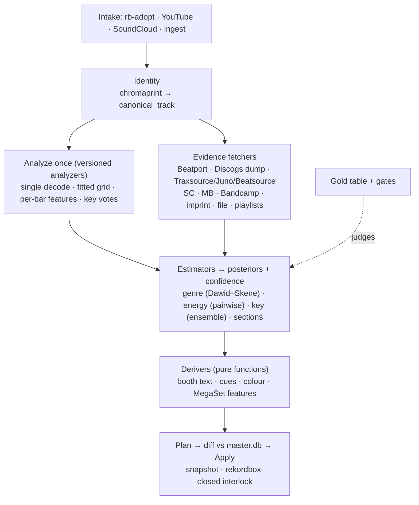

# FullTags v3 — Sept 2026 Landscape, Root Causes & Redesign Plan

**Status:** 🧭 PROPOSAL (the "why"; execution plan: `fulltags-v3-rebench-and-build-plan-2026-09-29.md`) — written 2026-09-28 against `analysis-pipeline-2026-09-29`, roadmap rev 7.14, `embedding-models` (v2 rerun), `genre-taxonomy` (Sep 14) and the Sep 28–29 session logs.
**Rule used throughout:** nothing here counts as *measured* unless it says so. Every proposal ends in a gate you can run.

---

## 0. TL;DR — the seven things that matter

1. **The BPM "phase-lock" is almost certainly a readout bug, not a model limit.** beat_this places beats on a 20 ms frame grid (50 fps). `tempo = 60 / median(diff(beats))` can therefore only return `3000 / n`: 136.36 (n=22), 130.43 (n=23), 125.00 (n=24). Both failure values quoted in roadmap #2 — **130.43** and **136.36** — are exactly those numbers. Fix: fit a straight line through *all* beats (§3). Expected result: the BPM write gate flips, the suspicious "Uptempo 130–139: 1,406 tracks" bucket shrinks, and grids line up with rekordbox.
2. **The genre vote ladder is an election where it needs to be an estimator.** Hand-set weights + plurality + special-case rules cannot learn that "MusicBrainz artist tags are wrong for remixes" or "file tags on pool rips are just Beatport again." Replace with a **Dawid–Skene label model** over family-level evidence, with audio as one cross-fitted voter and an explicit "not enough evidence" outcome (§4).
3. **Every genre comparison so far was graded against the labels under test.** "Probe lost to kNN," "Discogs-400 head worse than kNN," "MERT −19 pts" — all are *agreement with ladder labels*. Build independent **answer keys** (verified-store silver, agent silver, your binary ear-checks) and re-run those verdicts before believing them (§4.5).
4. **Two track-level evidence sources you don't have yet:** the **Discogs monthly dump** (CC0, offline, release styles in the exact vocabulary your effnet tower was trained on) and **store genres from Traxsource / Juno / Beatsource** (OneTagger already knows the endpoints). Meanwhile **demote artist-level sources for remixes/edits** — that's where they're systematically wrong.
5. **Energy is still a loudness meter.** Library average 8.5 on a 1–10 scale while average arousal is 4.92. Replace with a pairwise-calibrated composite measured on the drop section and banded by percentile against a frozen reference (§5).
6. **One challenger tower deserves a benchmark slot: OMAR-RQ** (MTG, 2025). Its value for you is **frame-level embeddings for per-bar work** (structure, transitions, energy curves) — not genre (§2.1, §7).
7. **EDM structure now has an off-the-shelf baseline:** the `edm98` package ships the EDM-98 dataset (labels built from rekordbox cue points: intro / buildup / drop / breakdown / outro) plus optional EDMFormer inference. Use it as gold + baseline, and bootstrap your own model from rekordbox's phrase analysis (§6).

---

## 1. Reconcile the docs first — they currently disagree

Before any new work: five places where two docs tell different stories. Each one will mislead a future session (human or agent).

| Topic | Doc A | Doc B | Resolution |
|---|---|---|---|
| Genre gate | Pipeline doc: **57.4% — BELOW GATE ❌** | Roadmap 7.14: baseline **57.0%** / arbitration **66.6% — PASS** | Two arms, one gate. Print both arms everywhere; state which arm the gate judges. |
| Energy formula | Pipeline doc: arousal → energy, RMS/"LUFS" as fallback | Roadmap #4: energy 2.0 = `0.5·RMS + 0.3·dance + 0.2·arousal`; session log: TXXX → `tracks.energy` → arousal | Three formulas. Document the one in code; add a test that recomputes 10 fixture tracks from the documented formula. |
| Cues per track | Pipeline doc: **30.0** avg | Session log: **~22** avg | Define it once (phrase cues only? phrase + memory?). |
| Discogs-400 head | Roadmap #4: "no ONNX export, saturated — genre writes deferred indefinitely" | Taxonomy §2: measured **46.1% top-1 / ~77% top-5** on cached embeddings, ~1 ms/track | The head clearly runs on cached vectors. Update #4. |
| Segment embeddings | Pipeline doc: "prerequisites all ✅" | #113: **REJECTED** — the ledger stores whole-track time-mean vectors only | #113 is right about the ledger. What's wrong is the "no re-analysis" acceptance rule — see §7 (the rerun is ~45 min). |
| Genre provenance | rekordbox shows genre on **3,819 / 3,819** | Ladder covers **3,406 / 3,607** rekordbox-adopted rows | ~400 rekordbox genres came from somewhere else (file tags?). Give them a provenance value so "never guessed" stays true. |

---

## 2. Sept 2026 landscape — what's current, per task

Legend: ✅ adopt/keep · 🧪 earns one benchmark slot · 👀 watch · ❌ skip.
Licence note: a personal archive can use non-commercial (NC) weights; anything you'd ever publish or sell can't. Track licence per model from day one (you already do).

### 2.1 Audio representations (embeddings)

| Model | Year | Strength | Weights licence | Your data | Verdict |
|---|---|---|---|---|---|
| **Discogs-EffNet** (1280-d) | 2023 | Style-aware similarity; cheap (0.56 s/track measured) | CC BY-NC-SA | **Best of 6 towers** on your v2 benchmark | ✅ keep as primary |
| **OMAR-RQ** (MTG/UPF) | 2025 | Reported state of the art *among open self-supervised models* on tagging, pitch, chords, beat tracking, segmentation; frame-level output (25 Hz variants) | CC BY-NC-SA 4.0 | Not measured | 🧪 one slot, judged on **per-bar tasks** (structure on EDM-98, transitions), not genre |
| **MuQ / MuQ-MuLan** | 2025 | MARBLE averages; MuQ-MuLan = zero-shot tagging + text↔audio | Code MIT / weights CC BY-NC | Parked (no first-class ONNX) | 👀 only for text search ("dark rolling techno, female vox") |
| **MAEST** (Discogs 400) | 2023 | Transformer genre model; what `settag` uses for genre | CC BY-NC-SA | Not measured | 🧪 cheap to try via settag on gold |
| MERT-v1-95M | 2023 | — | CC BY-NC | Measured −19 pts vs effnet at 7× cost | ❌ (per-layer re-test optional, low priority) |
| CLAP (LAION/MS) | 2023 | Text alignment | Apache/MIT | Measured worst for kNN | ❌ for genre/similarity |
| CLaMP 3, Qwen2.5-Omni audio tower | 2025 | Cross-modal / generalist | varies | — | 👀 (both are now encoders in the MARBLE toolkit) |

**Reading:** the tower isn't your bottleneck — your own v2 benchmark and external review already concluded that. What changed since Sept 14 is only that OMAR-RQ gives you a credible *frame-level* option for the per-bar work below.

### 2.2 Beats / tempo

| Option | Status | Verdict |
|---|---|---|
| **beat_this** (CPJKU, MIT) | Still the practical open default | ✅ keep — **fix the tempo readout (§3)** |
| BeatFM, BeatMamba, beat-aware attention | Papers only; a public tracker notes no official code as of 2026-09-25 | 👀 |
| WaveBeat-style reformulation (ICASSP 2026) | Research | 👀 |
| livechord-beat-refiner | Already on your watch list | 👀 — likely unnecessary once §3 lands |

### 2.3 Key

| Option | Status | Verdict |
|---|---|---|
| **OpenKeyScan** | 80.7% exact vs rekordbox on your 88-track pilot | ✅ keep |
| Foundation-model probes | Literature: they underperform on key because they favour timbre/rhythm over harmonic detail | ❌ |
| Myna-Vertical (Apr 2026) | Masked-contrastive pretraining that *does* work for key | 👀 research-grade |
| **GiantSteps / GiantSteps+ EDM Key** (600 Beatport-sourced EDM excerpts) | Public gold | ✅ run your stack on it → a real accuracy number instead of "agreement with rekordbox" |

### 2.4 Structure / cue points

| Option | What it is | Verdict |
|---|---|---|
| **EDM-98 + EDMFormer** (`pip install edm98`) | 98 EDM tracks labelled from rekordbox cue points; labels intro/buildup/drop/breakdown/outro/silence; SongFormer architecture; optional inference CLI | ✅ gold format + baseline |
| **rekordbox phrase analysis (PSSI in ANLZ `.EXT`)** | Free weak labels on thousands of your own tracks; your ANLZ tooling already reads these files | ✅ training labels |
| all-in-one v3 / -mlx | Pop-trained (Harmonix) | 👀 hip-hop/pop subset only |
| Cue-point estimation via object detection (ISMIR 2024) | DJ cue detection | 👀 |

### 2.5 Label aggregation & label-noise tooling — **the missing layer**

| Tool | Licence | Use |
|---|---|---|
| **crowd-kit** (Toloka) | Apache-2.0 | Dawid–Skene, GLAD, MACE, Wawa, zero-based skill. Input = `task, worker, label` dataframe → posterior per task. **This replaces the W-table.** |
| Snorkel `LabelModel` | Apache-2.0 | Alternative weak-supervision aggregator |
| **cleanlab** `find_label_issues` | AGPL-3.0 (use as a local tool, don't vendor) | Rank likely-wrong labels from out-of-fold probabilities → review queue |

### 2.6 Metadata / evidence sources

| Source | Granularity | Licence / access | Verdict |
|---|---|---|---|
| **Discogs monthly dumps** | **Release** (styles, label, catno, tracklist) | **CC0**, offline; releases file ~10 GB compressed; a Rust loader ingests it in ~15 min on an M1 | ✅ new arm — styles match effnet's training taxonomy |
| **Traxsource / Juno Download / Beatsource** | Track | Store pages / APIs (see OneTagger) | ✅ new arms for house/techno (Traxsource, Juno) and open-format (Beatsource) |
| Last.fm `track.getTopTags` | Track (folksonomy with counts) | Free API key | 🧪 useful for hip-hop/pop, noisy for underground |
| iTunes Search API | Track (coarse `primaryGenreName`) | No auth | 🧪 family-level only (hip-hop vs pop vs dance) |
| AcoustID → MusicBrainz recording | Recording ID | You already fingerprint | ✅ for **exact identity**, not genre |
| MusicBrainz artist folksonomy | **Artist** | — | Keep, but **route by remixer** and let the label model learn its (low) remix reliability |
| Bandcamp artist tags | **Artist** | — | Same as MB |
| Imprint prior | **Label** | — | Keep as a weak voter |
| Your own rekordbox playlists | Track | Local | ✅ if you organise by genre/vibe — it's *your* taxonomy |

### 2.7 DJ-tool projects worth reading

| Project | Licence | What to take |
|---|---|---|
| **OneTagger** | GPL-3.0 | Platform clients + matching heuristics for Beatport, Traxsource, Juno, Discogs, MusicBrainz, Beatsource, iTunes, Bandcamp, Deezer. Upstream last pushed Feb 2026; a maintained headless/Docker fork exists. **Read as reference and re-implement in TS** (or shell out to `onetagger-cli` on scratch copies). Don't paste GPL code into megadj if it might ever ship. |
| **settag** | check | Staged-write → verify → apply UX; MAEST genre sampling modes (`middle` = 4 centre patches, ~2.2× faster than full); model-free metadata-hygiene rules |
| **essentia-autotagger** | check | Parent+leaf expansion of Discogs `Genre---Style`; clean multi-value tag writing per container |
| beets `lastgenre` | MIT | Canonicalisation **tree** + whitelist — the right shape for Tier-1 → family mapping |
| **deep-cuts, dupsonic** | — | Already in your blueprint list (ONNX + sqlite-vec; dupes) |
| MARBLE toolkit | — | Modular encoder harness if you ever want public-benchmark parity checks (optional) |

---

## 3. BPM: the 20 ms quantization bug

### 3.1 The arithmetic

beat_this outputs beat times on its frame grid: 22,050 Hz / hop 441 = **50 fps → 20 ms steps**. The interval between two detected beats is therefore always `n × 0.02 s`, and so is their median. That makes the median-based tempo a quantized value:

| n frames | tempo = 60 / (0.02·n) | Notes |
|---|---|---|
| 21 | 142.86 | |
| **22** | **136.36** | roadmap #2 failure value (RB said 133.33 → **+2.27%**) |
| **23** | **130.43** | roadmap #2 failure value (RB said 127.66 → **+2.17%**) |
| 24 | 125.00 | |
| 25 | 120.00 | |

A 128 BPM track has a period of 0.46875 s = 23.4 frames → the median lands on 23 → **130.43**. That's +1.9% — *inside* the 2% gate by luck, which is why about half the pilot "passed." And it explains why a house-heavy library shows **1,406 tracks in "Uptempo 130–139"**: 126–128 BPM tracks read as 130.43.

The rev 6 bar-lag autocorrelation readout improved things (16/24) but still operates on the same 20 ms grid.

### 3.2 Verify in one query (2 minutes)

```sql
-- If the top rows are integers or .5 values (22, 23, 23.5, 24…), the diagnosis is confirmed.
SELECT round(3000.0 / bpm_raw, 2) AS frames_per_beat, count(*) AS n
FROM beats
GROUP BY frames_per_beat
ORDER BY n DESC
LIMIT 15;
```

### 3.3 The fix — fit a line through every beat

With 300–800 beats per track, a least-squares slope estimates the period to well under 0.01 BPM, even though each beat is only ±10 ms precise.

```python
import numpy as np

def fit_constant_grid(beats: np.ndarray, max_resid_s: float = 0.035):
    """Robust constant-tempo fit: beat_time ≈ t0 + k * period.
    Returns bpm, t0, period, resid_rms, inlier_ratio."""
    if len(beats) < 16:
        return None
    p0 = float(np.median(np.diff(beats)))            # coarse (quantized) period
    k = np.round((beats - beats[0]) / p0).astype(int) # beat indices, absorbs missed beats
    keep = np.ones_like(beats, dtype=bool)
    for _ in range(3):                                # iterative outlier rejection
        period, t0 = np.polyfit(k[keep], beats[keep], 1)
        k = np.round((beats - t0) / period).astype(int)
        resid = beats - (t0 + k * period)
        keep = np.abs(resid) < max_resid_s
    resid_rms = float(np.sqrt(np.mean(resid[keep] ** 2)))
    return dict(bpm=60.0 / period, t0=t0, period=period,
                resid_rms=resid_rms, inlier_ratio=float(keep.mean()))
```

Refinements, in order of value:
1. **Variable-tempo flag:** if `resid_rms > 15 ms` or `inlier_ratio < 0.9`, mark the track `tempo_variable` and fit piecewise (split at the largest residual jump). Don't write TBPM for those.
2. **Grid phase:** choose the bar offset (0–3) that best matches beat_this's downbeats → `t0_downbeat`. This is the grid rekordbox needs.
3. **Sub-frame peaks (optional):** use `Audio2Frames` logits and parabolic interpolation around each peak for ~1–2 ms beat precision.
4. **Genre-aware octave fold:** hip-hop 70–100, D&B 160–180, everything else 100–150. Your half/double cases (75.7 vs 138.9) are a separate, smaller problem.

### 3.4 Tighten the gate while you're there

2% is far too loose for a beat grid: at 2% tempo error, the grid is a full beat off after ~12 bars. rekordbox stores BPM to 0.01.

| Gate | Old | New |
|---|---|---|
| BPM (constant-tempo tracks) | ≥80% within 2% | **≥95% within 0.1%** (≈0.13 BPM at 128) vs rekordbox, and vs GiantSteps Tempo as external gold |
| Grid phase | — | **≥95%** downbeat on rekordbox's bar "1" (compare against PQTZ) |

**Also check:** which BPM MegaSet's `±2% / ±6%` tempo curve reads. If it's beat_this's median value, set scoring has been comparing 130.43s and 125.00s that are really 128s and 126s.

---

## 4. Genre: why the ladder is still poor — and what replaces it

### 4.1 Symptoms (measured, from your own docs)

- **The revote made labels less audio-consistent.** `fetch --revote` grew elected rows from 169 → 2,794, and *both* eval arms fell ~2.7 pts (arbitration 69.3% → 66.6%). New ladder labels are worse than the curated ones they joined.
- Source audio-consistency: rekordbox 58.4% vs ingest 53.1% (v3). No source is close to truth.
- **742 tracks sit in family "edm"** — an umbrella the scorer has to abstain on.
- Remaining error mass: house → techno.

### 4.2 Root causes (each testable on gold)

1. **Fixed weights ≠ reliability.** The W-table has one number per source. Real reliability varies by **source × family**: Beatport is strong on techno/house and historically weak on hip-hop; SoundCloud uploader tags are noisy everywhere; MusicBrainz folksonomy is right about the *artist* and wrong about the *remix*.
2. **Granularity mismatch.** Only Beatport (and pool-rip file tags) are track-level. MusicBrainz and Bandcamp are artist-level, the imprint prior is label-level, SoundCloud is uploader-level. A DJ library is disproportionately remixes, edits and bootlegs — exactly where artist-level evidence breaks ("Drake — X (House Edit)").
3. **Correlated votes double-count.** Pool rips carry Beatport's genre in TCON. If both `file` and `beatport` vote, one opinion counts twice. Same for SoundCloud uploads re-ingested with the uploader's tag.
4. **Vote splitting across the hierarchy** *(check the code)*. If votes are summed per canonical Tier-1 label, {House, Deep House, Tech House} split three ways and a single Techno vote wins plurality. Elect the **family** first.
5. **No evidence floor.** "Highest total elects" means one weak vote elects. There is no "not enough evidence → unknown."
6. **Version-level match errors.** Beatport's Original Mix and a Remix share artist + title but differ in genre. The artist gate doesn't catch this; mix name / remixer + duration must.
7. **Audio isn't a voter** — it only shows up afterwards as a dispute flag.
8. **Non-acoustic target.** "edm" as a family is a marketing umbrella, not a sound.

### 4.3 The replacement: genre is a posterior, not an election

```mermaid
flowchart LR
    subgraph Evidence["Evidence (one row per source × track)"]
        BP["beatport:track"]
        DC["discogs:release"]
        TX["traxsource / juno / beatsource:track"]
        SC["soundcloud:uploader"]
        MB["musicbrainz:artist"]
        BC["bandcamp:artist"]
        IM["imprint:label"]
        FT["file:pool / file:other"]
        PL["playlist:yours"]
    end
    AU["audio:knn_oof + discogs400_oof<br/>(out-of-fold, no circularity)"]
    Evidence --> N["Normalize<br/>raw → Tier-1 → family"]
    N --> D["Dedupe correlated evidence<br/>(file TCON == BP string → one vote)"]
    D --> LM["Dawid–Skene label model<br/>learns a confusion matrix per source"]
    AU --> LM
    LM --> P{"max posterior ≥ τ ?"}
    P -- yes --> F["family + confidence + runner-up"]
    P -- no --> U["unknown → review queue<br/>(ranked by cleanlab)"]
    F --> T1["Tier-1 display label:<br/>most specific label from the most<br/>reliable track-level source in that family"]
    F --> S2["secondary families: posterior ≥ 0.25"]
```



**How it works, concretely:**

- **Annotators = source × granularity**, e.g. `beatport:track`, `discogs:release`, `traxsource:track`, `sc:uploader`, `mb:artist`, `mb:artist_original` (see remix routing), `bandcamp:artist`, `imprint:label`, `file:pool`, `file:other`, `playlist:yours`, `audio:knn_oof`, `audio:discogs400_oof`.
- **Remix routing:** parse titles for `(X Remix|Edit|Bootleg|Flip|VIP|Rework|Dub)`. For remixes, artist-level sources query the **remixer**; votes derived from the *original* artist are emitted as a separate annotator (`mb:artist_original`). The label model will learn that annotator is unreliable — no hand rule needed.
- **Dawid–Skene** estimates, by EM and without ground truth, a K×K confusion matrix per annotator plus class priors, then a posterior P(family | all votes) per track. It handles "Beatport is great for techno but not hip-hop" automatically. At ~5k tracks × ~8 annotators it runs in seconds.
- **Audio as an annotator:** use **out-of-fold** predictions (5-fold kNN, and the Discogs-400 head mapped to families) so the audio vote never sees the label it's voting on.
- **Decision:** accept when max posterior ≥ τ, with τ tuned on gold for a target precision (e.g. 90%). Everything else is `unknown` — honest, and routed to the review queue.
- **Tier-1 label** (what you see): within the elected family, the most specific label from the most reliable track-level source (reliability read off the learned confusion matrices).
- **Multi-genre:** families with posterior ≥ 0.25 become `genre_secondary`. Your top-2 agreement is already 77.6% — tracks genuinely live between two families.
- **Explainability:** `genre-why` shows each annotator's vote, its learned reliability for that family, and the posterior. That replaces explaining a W-table.

**What this deletes:** the W-table, tie-break toward the harder gate, the downgrade rule, `imprintStands`, and most of the dispute-flag special-casing. One estimator, one threshold.

```python
# genre_estimate.py — the whole estimator core
import pandas as pd
from crowdkit.aggregation import DawidSkene

votes = pd.read_sql(
    """SELECT track_id AS task, annotator AS worker, family AS label
       FROM genre_evidence
       WHERE family IS NOT NULL""", con)

ds = DawidSkene(n_iter=100)
proba = ds.fit_predict_proba(votes)     # tracks × families
reliability = ds.errors_                # per-annotator confusion matrices
# next: calibrate proba on gold (temperature or isotonic), pick τ for target precision
```

You already persist the full vote breakdown in `tracks.genre_votes`, so backfilling `genre_evidence` is a migration, not a re-fetch.

### 4.4 Taxonomy fixes

1. **Raw "EDM" / "Dance" / "Electronic" cast no family vote.** They're abstentions, not evidence.
2. **Redefine family "edm" as something acoustic** — e.g. `mainstage` = big room, electro house, festival progressive, future house. It's a coherent sound cluster; "EDM" isn't.
3. **Let gold decide the house/techno border.** If the gold confusion matrix shows tech house / minimal / deep tech as the fuzzy zone, a `tech-house` family may absorb most of the remaining error mass. The EDM-taxonomy literature finds ~19–23 natural acoustic families vs Beatport's 35, so your 9 is on the coarse side — fine for scoring, but it's a choice to revisit with data, not a law.
4. **Families should be *your* set-building categories.** The ones you'd actually group by when building a night.

### 4.5 Answer keys (revised 2026-09-29 — replaces the personal gold set)

Personally naming level-3 subgenres isn't a trustworthy key. Keys are now layered by what each is good at — full spec in `fulltags-v3-rebench-and-build-plan-2026-09-29.md` §2:

- **AK1 external public gold** (GiantSteps Tempo/Key/+, EDM-98) — BPM, key, structure.
- **AK2 rekordbox reference** — agreement, not truth.
- **AK3 verified-store silver** — Beatport/Traxsource/Juno labels on *audio-verified exact recordings*, evaluated leave-source-out. Main key for L2 and L3.
- **AK4 agent silver** — web-researched, cited verdicts on 300 hard cases (remixes, bootlegs, house/techno border).
- **AK5 your ear, no naming required** — binary disputes ("more house or more techno?"), triplets ("which would you mix into A?"), energy pairs.

### 4.5b Version identity — the remix fix (added 2026-09-29)

Fuzzy matching lets evidence about the *original* (e.g. Taylor Swift's acoustic version) vote on a *remix* (a trap-house bootleg). Fix identity before voting:

1. **Parse** every title into `baseTitle / originalArtists / versionType / versionArtists` (regex table; LLM fallback only for unparseable strings).
2. **Version gate** in the name-match SSOT: only same-version candidates produce `exact_recording` evidence.
3. **Preview-audio verification**: embed store previews (Beatport, iTunes, Deezer, SoundCloud) and match them against the track's per-bar embeddings; low match → demoted to `same_song_other_version`.
4. **Facts, not votes**: all sibling-version evidence collapses into one vote; the label model learns it's unreliable for remixes.
5. **Remixer prior**: for remixes, the remixer's catalogue genres are an annotator.

Spec: rebench plan §4 (WS3).

### 4.6 Verdicts to re-run on gold

| Prior verdict (vs ladder labels) | Why it may flip on gold |
|---|---|
| Linear probe lost to kNN (51.5% vs 62.6%) | 62.6% was *gated* kNN (it refuses ~20%); the probe was scored ungated. Compare **risk–coverage curves** at matched coverage. Also check class weighting (house 1,497 vs mood 25) and feature standardisation. |
| Discogs-400 head worse than kNN (46.1% top-1) | kNN can mimic the ladder's own noise; the head can't. Only gold can say which is closer to *you*. |
| MERT / musicnn / OMAR-RQ tower ranking | Same reason. |
| Ladder vs label model vs audio-only vs label model + audio | The comparison that decides §4.3. |

**Ship gate for the label model:** on gold, beats the current ladder by ≥5 pts accuracy **at equal coverage**, and reaches ≥90% precision at its chosen τ.

---

## 5. Energy — from loudness meter to "how hard does it hit"

**Measured problem:** average energy 8.5 (1–10) vs average arousal 4.92. RMS is clamped to −25…−8 dB; club masters sit around −8…−11 dB RMS, so almost everything lands at 8.9–10. The dance head is saturated too (0.98 on typical tracks), so the energy 2.0 blend inherits both saturations.

**Replacement:**

1. **Measure on the loudest 16 bars** (a drop proxy until §6 lands), not the whole track — intros and outros dilute everything.
2. **Features:** K-weighted short-term loudness (true LUFS), onset density, low-band (40–120 Hz) energy share, spectral flux, percussive/harmonic ratio (HPSS), BPM, arousal, per-bar loudness variance.
3. **Target = your judgement.** ~200 "which hits harder?" pairs in CrateDeck (≈10 min). Fit a Bradley–Terry / pairwise-logistic model on feature differences — the TuneJury recipe you already cite.
4. **Output:** continuous score → 1–10 bands by **percentile against a frozen reference set** (e.g. the collection as of 2026-10-01), re-baselined only deliberately. Whole numbers on the booth.
5. **Bonus:** the same model on per-bar features gives an **energy curve per track** for free — a better input to Set's arc chart than whole-track arousal.

**Gates:** ≥75% agreement on held-out pairs; every decile holds 8–12% of the library.

---

## 6. Structure & cues

1. **After §3:** the fitted grid gives exact bars.
2. **Phrase-phase search (cheap, big win):** choose the offset φ ∈ {0…7} bars that maximises novelty (per-bar loudness / onset / embedding change) at phrase boundaries. Fixes misanchored intros and pickups.
3. **Weak labels from rekordbox PSSI:** for tracks analysed with phrase analysis, map Intro/Up/Down/Chorus/Outro onto bars and train a small per-bar section classifier on per-bar features (§7).
4. **Evaluate on EDM-98** (via `edm98`) + 50 of your own tracks. Run EDMFormer's inference as the baseline; **if it wins on your gold, just use it.**
5. **Cue writer v2:** hot cues A mix-in · B first drop · C breakdown · D second drop · E mix-out; memory cues at section boundaries only (≈6–10); auto cues carry a name marker and are the only cues ever replaced. The full 8-bar grid stays in archive.db for MegaSet.

**Gate:** section boundaries within ±1 bar on ≥85% of gold; first-drop cue correct on ≥90%.

---

## 7. Per-bar feature store — the one re-analysis worth doing

#113 (transition-window similarity) was rejected because the ledger stores whole-track means and its acceptance forbade re-analysis. That rule costs more than it saves:

- effnet measured at **0.56 s/track** → ~45 min single-threaded for 4.5k tracks, ~12 min at `--jobs 4`.
- Store per-patch embeddings **pooled per bar**, PCA-reduced to 256-d, fp16 → **~66 KB/track, ~300 MB total**.
- Run the Essentia heads **per patch** → per-bar voice/instrumental, dance and mood curves for free. That's a first-cut **vocal density** signal with no Demucs.
- Unlocks: #113 transitions (outro(A) ↔ intro(B)), drop-weighted track embeddings (better genre *and* similarity), structure features (§6), energy curves (§5).
- OMAR-RQ's 25 Hz embeddings are the challenger for this table — benchmark it on the EDM-98 structure task.

---

## 8. The whole system — simple, and scales linearly



**Principles:**
1. **Identity by fingerprint**, not by source key.
2. **Analyze once** — the expensive step produces durable, versioned artefacts; everything else re-derives in seconds.
3. **Store evidence, not answers** — `genre_evidence`, key votes, BPM candidates.
4. **Estimators output posteriors with confidence**, and "unknown" is a valid output.
5. **Gold judges estimators** — never agreement with the system's own labels.
6. **Derivers are pure functions** — change a formula, re-render, no audio.
7. **Plan/apply sync** to rekordbox, as you already do.

**Scale:** everything is O(n) per track. Dawid–Skene EM takes seconds at 10k tracks; brute-force cosine is fine to ~50k; beyond that, sqlite-vec.

### 8.1 Schema additions

```sql
CREATE TABLE genre_evidence (
  track_id    TEXT NOT NULL,
  annotator   TEXT NOT NULL,        -- e.g. 'beatport:track', 'mb:artist_original'
  raw         TEXT,                 -- as the source said it
  tier1       TEXT,                 -- canonical label
  family      TEXT,                 -- NULL = abstain (EDM/Dance/Electronic, junk)
  granularity TEXT CHECK (granularity IN ('track','release','artist','label','uploader','user')),
  match_conf  REAL,                 -- search/match confidence
  source_ref  TEXT,                 -- URL / ID for genre-why
  fetched_at  TEXT,
  PRIMARY KEY (track_id, annotator)
);

CREATE TABLE genre_posterior (
  track_id      TEXT PRIMARY KEY,
  family        TEXT, p  REAL,
  family2       TEXT, p2 REAL,
  tier1         TEXT,
  status        TEXT CHECK (status IN ('accepted','unknown','gold')),
  model_version TEXT, computed_at TEXT
);

CREATE TABLE bar_features (
  track_id TEXT, bar INTEGER, t0 REAL, t1 REAL,
  lufs_st REAL, onset_density REAL, low_share REAL, flux REAL,
  voice_p REAL, dance_p REAL,
  emb BLOB,                          -- fp16, PCA-256
  PRIMARY KEY (track_id, bar)
);
```

---

## 9. Steal list — what to take and how

| Project | Licence | Take | How |
|---|---|---|---|
| **crowd-kit** | Apache-2.0 | Dawid–Skene, GLAD, MACE | Dependency via `uv --with` |
| **Discogs dumps** | CC0 | Offline release → styles / label / catno index | Load with a dump loader, filter to Electronic + Hip Hop + Pop, keep in SQLite |
| **OneTagger** | GPL-3.0 | Traxsource / Juno / Beatsource / Discogs / iTunes / Deezer endpoints and match heuristics | Reference only; re-implement in TS (or subprocess the CLI) |
| **cleanlab** | AGPL-3.0 | `find_label_issues` → review-queue ranking | Local tool, not vendored |
| **edm98 / EDMFormer** | check | EDM section gold + baseline | pip; eval harness |
| **settag** | check | Staged-write UX; genre sampling modes; metadata hygiene rules | Pattern reference |
| **essentia-autotagger** | check | Parent+leaf Discogs expansion; multi-value tag writing | Pattern reference |
| beets `lastgenre` | MIT | Canonicalisation tree + whitelist | Copy the structure for Tier-1 → family |
| **OMAR-RQ** | weights CC BY-NC-SA 4.0 | Frame-level embeddings | 🧪 benchmark on per-bar tasks |
| GiantSteps Key / Tempo, GiantSteps+ | check | External gold for key / BPM | Download; eval |
| beat_this `Audio2Frames` | MIT | Frame logits → sub-frame beats | Already a dependency |

---

## 10. The plan

**Superseded by `fulltags-v3-rebench-and-build-plan-2026-09-29.md`** — answer keys, bench harness, 12 workstreams, tickets, gates and agent prompts live there. Tracked as GitHub issues with the `fulltags-v3` label.

---

## 11. What not to do

- **Don't tune the W-table further** — it's being replaced.
- **Don't add more genre sources before the label model exists.** Under plurality voting, each new noisy source makes things worse — the revote already showed that.
- **Don't use LLMs for per-track genre.** String → vocabulary mapping only, as your taxonomy doc already says.
- **Don't run Demucs** until per-bar voice probabilities prove insufficient.
- **Don't fine-tune MERT or MuQ.** Frozen features plus the right readout is enough at 4–10k tracks.

---

## 12. Sources

- OMAR-RQ paper — https://arxiv.org/abs/2507.03482 · code — https://github.com/mtg/omar-rq
- MARBLE toolkit (encoder registry incl. MuQ, MuQ-MuLan, CLaMP 3, Qwen2.5-Omni) — https://github.com/a43992899/MARBLE-Benchmark
- beat_this — https://github.com/CPJKU/beat_this
- Beat-tracking candidates without official code (tracker, 2026-09-25) — https://github.com/bolph71656-ai/HornScribe/issues/387
- Key detection & foundation models (Myna-Vertical) — https://arxiv.org/pdf/2604.10021
- GiantSteps+ EDM Key dataset — https://zenodo.org/record/1095691
- EDM-98 / EDMFormer package — https://pypi.org/project/edm98/ · paper — https://awesomepapers.io/speech-audio/papers/2603.08759
- EDM taxonomy overspecification — https://arxiv.org/abs/2509.11474
- crowd-kit — https://github.com/Toloka/crowd-kit
- Discogs data dumps (CC0) — https://data.discogs.com/ · Rust loader — https://github.com/DylanBartels/discogs-load
- OneTagger — https://github.com/Marekkon5/onetagger · headless fork — https://github.com/deviationist/onetagger
- settag — https://pypi.org/project/settag/
- essentia-autotagger — https://pypi.org/project/essentia-autotagger/
