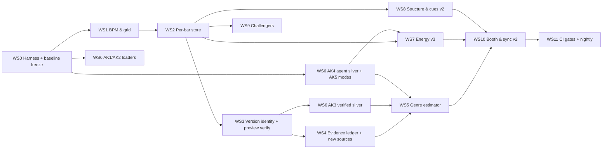

# FullTags v3 — Rebench & Build Plan

**Status:** 🧭 PLAN OF RECORD — 2026-09-29
**Companion to:** `fulltags-v3-landscape-and-redesign-2026-09-28.md` (the "why"). This doc is the "how": answer keys, one bench harness, 12 workstreams, tickets with acceptance tests, gates, and agent kickoff prompts.
**Supersedes:** v3 doc §4.5 (personal gold set) → replaced by §2 here. **Adds:** version identity (§4, WS3).
**Tracked:** GitHub issues with `fulltags-v3` label; epic [#346](https://github.com/webuildstuffio/megadj/issues/346).

---

## 0. Goal, rules, definition of done

**Goal:** every stage of FullTags is re-measured against an answer key it didn't produce, then rebuilt where it loses. After this, every number in a status doc is an accuracy number, not a coverage number.

**Rules for every ticket (humans and agents):**
1. **Baseline before change.** No ticket that changes a stage merges without a `bench run` of that stage on `main` first, and a `bench compare` after.
2. **Answer keys never train what they grade.** Leave-source-out when a source is both a voter and a key.
3. **Evidence, not answers.** New sources write to evidence tables; only estimators write final fields.
4. **No silent writes.** Anything touching files or `master.db` goes through plan → diff → apply, with snapshot and the rekordbox-closed interlock.
5. **Tests first for parsers and math** (BPM fit, version parser, label model wrapper).
6. **Docs move with code.** A ticket that changes a number updates the doc that states it, in the same PR.
7. `bun run check:full` green on every PR.

**Definition of done for v3:**
- `megadj bench all` runs end-to-end and writes one report.
- Every stage has a gate in §6 that passes, or a documented "gate failed → stage stays read-only" decision (the pattern you already use for TBPM).
- The rekordbox booth output is rendered only from gated fields.

---

## 1. The rebench matrix — what gets measured, against what

| Stage | Today's claim | Metric | Answer key(s) | Harness verb |
|---|---|---|---|---|
| Identity / dedupe | Fingerprints stamped | Duplicate-cluster precision; cross-source dupes found | Fingerprint clusters + manual spot check of 30 clusters | `bench run identity` |
| **Version match** | *(not measured)* | % of genre votes about a *different recording*; match precision | Preview-audio verification (§4.3) | `bench run version-match` |
| BPM | Gate failed 12/24 @2% | % within 0.1% / 1%; octave-error rate | rekordbox BPM (reference), GiantSteps Tempo (external) | `bench run bpm` |
| Grid phase | Cross-check only | % downbeat on rekordbox bar "1"; mean phase error (ms) | rekordbox PQTZ grid | `bench run grid` |
| Key | 80.7% exact vs RB (88 tracks) | Exact %, MIREX weighted score | GiantSteps Key / GiantSteps+ (external), rekordbox (reference) | `bench run key` |
| Genre L2 (family) | 57.0 / 66.6% agreement vs ladder | Accuracy @ coverage curve; coverage @ 90% precision; macro-F1; confusion | Verified-store silver (leave-source-out), agent silver, your binary disputes | `bench run genre-l2` |
| Genre L3 (subgenre) | *(not measured)* | Top-1 / top-3; calibration error (ECE) | Verified-store subgenres, agent silver | `bench run genre-l3` |
| Energy | avg 8.5 (saturated) | Decile spread; genre-family separation; arousal/BPM/RMS independence | Multi-feature composite (z-score normalized, 8 signals, no manual labels — see `energy-v3-plan-2026-10-01.md`) | `bench run energy` |
| Mood heads | 5 heads, ≥0.5 fires | Fire rate per head; information (entropy) | Distribution check (no key needed) | `bench run mood` |
| Structure / cues | Coverage only | Boundary F-measure ±1 bar; first-drop hit rate | EDM-98, rekordbox PSSI (weak), your drop checks | `bench run structure` |
| Similarity | Coherence 0.362 (vs noisy labels) | Triplet accuracy; hubness skew; family coherence | Your triplets, verified-store silver | `bench run similarity` |
| Booth / sync | 99.6% full comments | Round-trip correctness; manual cues untouched; string info content | Read-back of `master.db` after apply on a scratch copy | `bench run sync` |
| Performance | s/track per stage | s/track, peak RAM, disk | — | `bench run perf` |

---

## 2. Answer keys — how each one is built

You're right that personally naming level-3 subgenres isn't a good answer key. So the keys are layered by what each is actually good at.

| Key | Good for | How it's built | Size | Your time |
|---|---|---|---|---|
| **AK1 External public gold** | BPM, key, EDM structure | GiantSteps Tempo, GiantSteps Key, GiantSteps+ EDM Key, EDM-98. Audio via GetDat where legally obtainable; annotations from the datasets | ~600 excerpts per key set; 98 full tracks | 0 |
| **AK2 rekordbox reference** | BPM, grid phase, key, phrases | `pyrekordbox`: BPM ×100, `DjmdKey.ScaleName`, ANLZ PQTZ grid, PSSI phrases. **A reference, not truth** — reported as agreement | 3,819 | 0 |
| **AK3 Verified-store silver** | Genre L2 + L3 | Tracks where Beatport / Traxsource / Juno matched the **exact recording**, confirmed by preview audio (§4.3). Store genre + subgenre = label. Evaluate **leave-source-out**: when Beatport is the key, the Beatport vote is removed for that track | Target 800–1,500 | 0 |
| **AK4 Agent silver** | Genre L2 + L3 on the hard cases (remixes, bootlegs, house/techno border) | An agent with web search assembles an evidence packet per track (store pages, Discogs release, remixer's catalogue, label) and adjudicates with citations and a confidence. JSON schema, cached | 300, stratified to hard cases | 0 (spot-check 20) |
| **AK5 Your ear** | Binary disputes, similarity, energy | Three quick CrateDeck modes (below). No genre naming required | 150 disputes · 200 triplets · 200 energy pairs | ~40 min total, in 10-min sessions |

**AK5 modes (build once, reuse forever):**
- **Dispute:** plays 8 s at the drop. Prompt: "more **house** or more **techno**?" (the two candidates the system is torn between). Keys: `←` / `→` / `?`.
- **Triplet:** plays A, then B and C. "Which one would you mix into A?" Trains and tests similarity — the thing MegaSet actually uses.
- **Energy pair:** "Which hits harder at the drop?"

**Leakage rules (enforced in the harness, not by convention):**
- A key row carries `source_of_truth`. The harness drops that source's evidence for that track before estimating.
- AK3/AK4/AK5 rows are **excluded from training and threshold fitting** unless the run is explicitly a calibration run on a separate split (`--split calib`, fixed seed, 50/50).

---

## 3. One bench harness

### 3.1 Commands

```
megadj bench run <stage> [--key AK1|AK2|AK3|AK4|AK5|all] [--split eval|calib] [--json]
megadj bench run all
megadj bench compare <runA> <runB>          # bootstrap CIs + McNemar on paired rows
megadj bench baseline freeze --tag <name>   # snapshot every stage on current main
megadj bench report [--since <tag>]         # writes docs/fulltags/bench/<date>.md
```

### 3.2 Storage

```sql
CREATE TABLE bench_runs (
  run_id      TEXT PRIMARY KEY,           -- ulid
  stage       TEXT NOT NULL,
  answer_key  TEXT NOT NULL,
  split       TEXT NOT NULL DEFAULT 'eval',
  git_sha     TEXT NOT NULL,
  config_hash TEXT NOT NULL,              -- analyzer versions + params
  n           INTEGER NOT NULL,
  metrics     TEXT NOT NULL,              -- JSON: headline + secondaries
  ci          TEXT,                       -- JSON: bootstrap 95% CIs
  created_at  TEXT NOT NULL
);
CREATE TABLE bench_rows (                 -- per-track outcomes → paired tests
  run_id TEXT, track_id TEXT, truth TEXT, pred TEXT, conf REAL, correct INTEGER,
  PRIMARY KEY (run_id, track_id)
);
CREATE TABLE answer_keys (
  key_id TEXT, track_id TEXT, field TEXT, value TEXT, confidence REAL,
  source_of_truth TEXT, split TEXT, evidence TEXT, created_at TEXT,
  PRIMARY KEY (key_id, track_id, field)
);
```

### 3.3 Statistics (same everywhere)
- Bootstrap 95% CIs (1,000 resamples) on every headline metric.
- McNemar on paired rows for A-vs-B decisions.
- **Risk–coverage curves** for anything that can abstain (genre, key). Compare methods at equal coverage — this fixes the old probe-vs-gated-kNN mismatch.
- Minimum n per reported cell: 30. Smaller cells print, flagged `low-n`.

### 3.4 Placement
- TS orchestration: `src/fulltags/bench/` (`runner.ts`, `stats.ts`, `report.ts`, one `stages/<stage>.ts` per row of §1).
- Python metric helpers (mir_eval for key/beats/segments): `src/fulltags/bench/py/`, run under `uv --with`.
- `tools/emb_benchmark.py` becomes `stages/towers.ts` + a Python adapter; the old harness is kept until parity is shown.

---

## 4. Version identity — the remix fix (spec)

### 4.1 Parser

src/fulltags/identity/version.ts (planned)

```ts
export type VersionType =
  | "original" | "extended" | "radio" | "remix" | "edit" | "bootleg" | "flip"
  | "vip" | "rework" | "dub" | "instrumental" | "acapella" | "acoustic" | "live" | "unknown";

export interface VersionIdentity {
  baseTitle: string;          // normalized, NFC + casefold via name-key SSOT
  originalArtists: string[];  // split on feat./&/x/,/vs.
  featured: string[];
  versionType: VersionType;
  versionArtists: string[];   // remixer(s) / editor(s)
  rawVersion: string | null;  // text inside the brackets, verbatim
  confidence: number;         // 1.0 = clean regex hit; <0.7 → LLM fallback
  parser: "regex" | "llm";
}
export function parseVersion(title: string, artistField: string): VersionIdentity;
```

**Regex table** (ordered, first hit wins, each pattern unit-tested):
- `(<X> Remix)`, `[<X> Remix]`, `- <X> Remix`, `(<X> Re-Mix)`, `(<X> Rmx)`
- `(<X> Edit)`, `(<X> Bootleg)`, `(<X> Flip)`, `(<X> VIP)`, `(<X> Rework)`, `(<X> Dub)`, `(<X> Refix)`
- `(Extended Mix)`, `(Original Mix)`, `(Radio Edit)`, `(Club Mix)` → no version artist
- `(Acoustic)`, `(Live …)`, `(Instrumental)`, `(Acapella)`
- `feat.` / `ft.` / `featuring` in title or artist field → `featured`
- Nested / double brackets (`(X Remix) [Extended]`) → versionType from the most specific bracket
- Artist field containing the remixer (`Taylor Swift, X`) with title `(X Remix)` → X moves to `versionArtists`

**LLM fallback:** only when `confidence < 0.7`. OpenRouter, temperature 0, JSON-schema output identical to `VersionIdentity`, cached by `sha256(title|artist)`. The output is validated; if invalid → `unknown`. No per-track genre ever comes from this call.

**Fixture:** export 300 real titles from `archive.db` (stratified: 150 with brackets, 50 with feat., 50 bootleg/edit, 50 plain) → src/fulltags/identity/test/titles.fixture.json (planned), hand-verified once (this is string parsing, not genre — easy to check).

### 4.2 Version gate

Extend the name-match SSOT (`src/fulltags/sources/name-match.ts`):

```ts
export function versionCompatible(q: VersionIdentity, c: VersionIdentity): "exact" | "sibling" | "reject";
// exact:   same baseTitle, same versionType class, overlapping versionArtists (or both none)
// sibling: same baseTitle + originalArtists, different version  → evidence_scope = same_song_other_version
// reject:  anything else
```

Every source client (SC, BP, Bandcamp, Traxsource, Juno, Beatsource, Discogs, iTunes, Deezer, MB) parses the **candidate's** title with the same parser and calls `versionCompatible`. Only `exact` candidates can produce `exact_recording` evidence.

### 4.3 Preview-audio verification

src/fulltags/identity/preview_verify.py (planned worker, `uv --with onnxruntime`)

- **Inputs:** candidate preview URL (Beatport sample, iTunes `previewUrl`, Deezer `preview`, SoundCloud stream via yt-dlp), and `track_id`.
- **Method:** decode the preview → effnet patch embeddings → slide over the track's per-bar embeddings (WS2) → `audio_match = max mean cosine` over aligned windows. Optional second opinion: raw chromaprint cross-correlation with offset search.
- **Output:** `audio_match` score, `offset_s`, `method`. Preview audio is temp-only and never kept.
- **Calibration (AK-internal, automatic):**
  - Positives = random 30–60 s slices of your own files matched against themselves, plus known duplicate pairs from fingerprint clusters.
  - Negatives = pairs with the same `baseTitle` and a different version (you have many: originals vs remixes in the library).
  - Pick the threshold at ≥99% precision on positives-vs-negatives. Report the ROC.
- **Rule:** `exact` + `audio_match ≥ τ_audio` → `evidence_scope = exact_recording, verified = 1`. `exact` without a preview → `exact_recording, verified = 0` (still counts, lower learned reliability). Below τ → demoted to `same_song_other_version`.

### 4.4 Evidence scope and "facts, not votes"

```sql
ALTER TABLE genre_evidence ADD COLUMN evidence_scope TEXT
  CHECK (evidence_scope IN ('exact_recording','same_song_other_version','artist','remixer','label','uploader','user'));
ALTER TABLE genre_evidence ADD COLUMN verified INTEGER DEFAULT 0;
ALTER TABLE genre_evidence ADD COLUMN audio_match REAL;
```

- The **annotator id includes the scope**: `beatport:exact_recording`, `beatport:same_song_other_version`, `mb:artist`, `mb:remixer`, …
- All `same_song_other_version` evidence for one track **collapses into a single vote** before estimation (the family with the most mass among siblings, weight = one voter). Five sources describing the Taylor Swift original = one fact.
- **Remixer prior:** for `versionType ∈ {remix, edit, bootleg, flip, vip, rework}`, fetch the remixer's catalogue genres (Beatport artist page, SoundCloud profile tags, Discogs artist styles) → annotator `remixer:catalog`.

### 4.5 The diagnostic you get for free

`bench run version-match` on the **current** `tracks.genre_votes` reports: *X% of today's genre votes are about a different recording than the file.* That single number tells you how much of "genre quality is still poor" is identity rather than taxonomy.

---

## 5. Workstreams & tickets

Effort: S < 1 day · M 1–3 days · L > 3 days. IDs are proposed GitHub issue titles.

### WS0 — Baseline freeze & doc truth (S) · *first, blocks everything*
| Ticket | Scope | Acceptance |
|---|---|---|
| **[B0.1](https://github.com/webuildstuffio/megadj/issues/347)** Bench harness skeleton | `src/fulltags/bench/` runner, `bench_runs`/`bench_rows`/`answer_keys` migrations, `stats.ts` (bootstrap, McNemar, risk–coverage), report writer | Unit tests for stats vs known values; `bench run mood` works end-to-end |
| **[B0.2](https://github.com/webuildstuffio/megadj/issues/348)** Port existing evals into the harness | genre LOO (`genre --eval` arms), tower benchmark, grid cross-check, key gate → `stages/*.ts` | Parity: harness numbers equal the legacy commands' output ±0.1 pt |
| **[B0.3](https://github.com/webuildstuffio/megadj/issues/349)** Baseline freeze | `bench baseline freeze --tag v2-final` on today's `main` | Report committed to `docs/fulltags/bench/` |
| **[B0.4](https://github.com/webuildstuffio/megadj/issues/350)** Doc reconciliation | Six contradictions from v3 doc §1; energy formula pinned by a fixture test | Docs agree; test green |

### WS1 — BPM & grid (S) · *critical path*
| Ticket | Scope | Acceptance |
|---|---|---|
| **[B1.1](https://github.com/webuildstuffio/megadj/issues/351)** Confirm quantization | The `3000/bpm_raw` query as `bench run bpm --diagnose` | Histogram printed; diagnosis recorded in doc |
| **[B1.2](https://github.com/webuildstuffio/megadj/issues/352)** `fit_constant_grid` | Robust line fit + variable-tempo flag + bar phase (v3 doc §3.3) in the beats worker; new columns `bpm_fit, t0, period, resid_rms, inlier_ratio, tempo_variable, downbeat_phase` | Unit tests on synthetic beats (jitter ±10 ms, missed beats, tempo change) |
| **[B1.3](https://github.com/webuildstuffio/megadj/issues/353)** Genre-aware octave fold | Family prior ranges, applied after L2 exists (fallback to 100–150) | Octave-error rate reported |
| **[B1.4](https://github.com/webuildstuffio/megadj/issues/354)** Regate BPM + grid | New gates §6 | Pass → unblock TBPM writes behind existing gate harness |
| **[B1.5](https://github.com/webuildstuffio/megadj/issues/355)** MegaSet BPM source audit | Which BPM feeds the ±2%/±6% curve; switch to `bpm_fit` if it's the median | Set rebuild diff report |

### WS2 — Per-bar feature store (M) · *critical path*
| Ticket | Scope | Acceptance |
|---|---|---|
| **[B2.1](https://github.com/webuildstuffio/megadj/issues/356)** `bar_features` table + writer | Per-bar pooling of effnet patches (PCA-256 fp16), LUFS-short-term, onset density, low-band share, flux | 10-track fixture round-trip; size ≤ 80 KB/track |
| **[B2.2](https://github.com/webuildstuffio/megadj/issues/357)** Per-patch heads | voice/instrumental, dance, mood heads per bar | Curves stored; fire-rate report |
| **[B2.3](https://github.com/webuildstuffio/megadj/issues/358)** Library rerun | `megadj analyze --bars --jobs 4`, resumable | All 4.5k tracks; wall-clock recorded (expect ~12 min effnet + features) |
| **[B2.4](https://github.com/webuildstuffio/megadj/issues/359)** PCA basis versioning | Fit on the frozen reference set; `pca_version` in `config_hash` | Changing basis forces a clean rebuild |

### WS3 — Version identity (M) · *critical path for genre*
| Ticket | Scope | Acceptance |
|---|---|---|
| **[B3.1](https://github.com/webuildstuffio/megadj/issues/360)** `parseVersion` + regex table | §4.1 | ≥98% exact on the 300-title fixture (regex + LLM) |
| **[B3.2](https://github.com/webuildstuffio/megadj/issues/361)** LLM fallback | Cached, schema-forced, validated | 0 invalid writes; cache hit on rerun |
| **[B3.3](https://github.com/webuildstuffio/megadj/issues/362)** `versionCompatible` in name-match SSOT; wire all source clients | §4.2 | Every client test updated; census test proves no client bypasses it |
| **[B3.4](https://github.com/webuildstuffio/megadj/issues/363)** Preview verification worker + calibration | §4.3 | ROC reported; τ_audio chosen at ≥99% precision |
| **[B3.5](https://github.com/webuildstuffio/megadj/issues/364)** `evidence_scope` + sibling collapse + remixer prior | §4.4 | Taylor-Swift-style fixture: 1 remix vote beats 5 sibling votes |
| **[B3.6](https://github.com/webuildstuffio/megadj/issues/365)** Version-match diagnostic | §4.5 | Headline number published |

### WS4 — Evidence ledger & new sources (M–L)
| Ticket | Scope | Acceptance |
|---|---|---|
| **[B4.1](https://github.com/webuildstuffio/megadj/issues/366)** `genre_evidence` migration + backfill from `tracks.genre_votes` | Scope/granularity columns | Row count parity with the ladder breakdowns |
| **[B4.2](https://github.com/webuildstuffio/megadj/issues/367)** Discogs dump arm | Monthly CC0 dump → filtered SQLite index (Electronic, Hip Hop, Pop, Funk/Soul); match by label+catno (from Beatport) → artist+title+version | Match rate on 500-track sample; styles mapped to L3 vocabulary |
| **[B4.3](https://github.com/webuildstuffio/megadj/issues/368)** Traxsource / Juno / Beatsource clients | Endpoints and match heuristics studied from OneTagger (GPL — reference only, re-implemented in TS) | Per-client fixture tests; version gate enforced |
| **[B4.4](https://github.com/webuildstuffio/megadj/issues/369)** iTunes + Deezer arms | Coarse genre (L2 only) + **preview URLs** for B3.4 | Preview availability rate reported |
| **[B4.5](https://github.com/webuildstuffio/megadj/issues/370)** Last.fm track tags (optional) | Track-level folksonomy with counts | Learned reliability decides if it stays |
| **[B4.6](https://github.com/webuildstuffio/megadj/issues/371)** Your playlists as evidence | rekordbox playlist membership → `user` scope annotator if a playlist is ≥70% one family | Opt-in config |

### WS5 — Genre estimator (M)
| Ticket | Scope | Acceptance |
|---|---|---|
| **[B5.1](https://github.com/webuildstuffio/megadj/issues/372)** Taxonomy v3 | Umbrella strings (EDM/Dance/Electronic) abstain; `edm` family → acoustic definition; L3 vocabulary = Discogs styles ∪ store subgenres with a `style_map` table | Mapping coverage report |
| **[B5.2](https://github.com/webuildstuffio/megadj/issues/373)** L2 label model | Dawid–Skene (crowd-kit) over family-level evidence; audio out-of-fold annotators (5-fold kNN, Discogs-400→family) | Converges; per-annotator reliability printed |
| **[B5.3](https://github.com/webuildstuffio/megadj/issues/374)** L2 calibration + τ | Temperature/isotonic on AK3+AK4 `calib` split; τ for 90% precision | ECE ≤ 0.05 on `eval` split |
| **[B5.4](https://github.com/webuildstuffio/megadj/issues/375)** L3 ranked styles | Within elected family: combine store subgenres (by learned reliability) + Discogs-400 head probabilities → top-3 with calibrated probabilities | Top-3 gate §6 |
| **[B5.5](https://github.com/webuildstuffio/megadj/issues/376)** Write path swap | `genre_posterior` becomes the source for `tracks.genre` behind a flag; ladder kept as a read-only annotator for one release | Bake-off gate passes first |
| **[B5.6](https://github.com/webuildstuffio/megadj/issues/377)** `genre-why` v2 | Shows evidence rows, scope, verification, learned reliability, posterior | Snapshot test |
| **[B5.7](https://github.com/webuildstuffio/megadj/issues/378)** Review queue | cleanlab-ranked disagreements → AK5 dispute mode | Queue populated |

### WS6 — Answer-key builders (M)
| Ticket | Scope | Acceptance |
|---|---|---|
| **[B6.1](https://github.com/webuildstuffio/megadj/issues/379)** AK1 loaders | GiantSteps Tempo/Key/+ and EDM-98 annotation loaders; audio availability report | Loader tests |
| **[B6.2](https://github.com/webuildstuffio/megadj/issues/380)** AK2 extractor | rekordbox BPM/key/PQTZ/PSSI into `answer_keys` (reference) | Row counts |
| **[B6.3](https://github.com/webuildstuffio/megadj/issues/381)** AK3 builder | Verified-store silver after B3.4; `split` assignment (fixed seed) | ≥800 rows target |
| **[B6.4](https://github.com/webuildstuffio/megadj/issues/382)** AK4 agent silver | Agent job with web search, schema'd packet (claims + URLs + confidence), cached; 20-row spot-check UI | 300 rows; spot-check agreement recorded |
| **[B6.5](https://github.com/webuildstuffio/megadj/issues/383)** AK5 CrateDeck modes | Dispute / triplet / energy-pair pages; keyboard-driven; drop-start playback | 10-min sessions work on the XDJ-free laptop flow |

### WS7 — Energy v3 (S–M) · *see `energy-v3-plan-2026-10-01.md`*

**Superseded:** the pairwise-label approach (B7.2 Bradley–Terry) is replaced
by a multi-feature composite with z-score normalization that needs NO manual
labels. Full design in `docs/fulltags/energy-v3-plan-2026-10-01.md`.

| Ticket | Scope | Acceptance |
|---|---|---|
| **[B7.1](https://github.com/webuildstuffio/megadj/issues/384)** Energy feature extraction (8 features, drop-section) | Python essentia extractor: hf_ratio, onset_density, spectral_centroid, dynamic_complexity, spectral_flux, low_band_share, lufs_drop + arousal from mood table; `energy_features` table; runs on drop section from beats ledger | Fixture test; all 8 features populated for 10-track sample |
| **[B7.2](https://github.com/webuildstuffio/megadj/issues/385)** Library z-score freeze + composite scoring | Compute library-wide mean/std per feature → `energy_reference` table; weighted composite z-scores → E1–E9 percentile bands | Decile spread gate (8–12% per band); saturation gate (<15% top band) |
| **[B7.3](https://github.com/webuildstuffio/megadj/issues/386)** Automatic validation gates | Genre-family separation (Cohen's d > 0.5), arousal correlation (0.3 < r < 0.8), BPM independence (|r| < 0.3), RMS independence (|r| < 0.5), feature contribution balance | All gates pass |
| **[B7.4](https://github.com/webuildstuffio/megadj/issues/387)** Per-bar energy curve | Composite model on per-bar features → Set arc input | Set arc renders from curve |

### WS8 — Structure & cues v2 (M–L)
| Ticket | Scope | Acceptance |
|---|---|---|
| **[B8.1](https://github.com/webuildstuffio/megadj/issues/388)** Phrase-phase search | Offset φ ∈ {0…7} maximizing boundary novelty | Improvement vs anchored phrases on EDM-98 |
| **[B8.2](https://github.com/webuildstuffio/megadj/issues/389)** PSSI weak labels → per-bar section classifier | Logistic or small GRU over `bar_features` | Boundary F ±1 bar |
| **[B8.3](https://github.com/webuildstuffio/megadj/issues/390)** EDMFormer baseline | `edm98` inference on EDM-98 + your first-drop checks | If it wins, adopt it |
| **[B8.4](https://github.com/webuildstuffio/megadj/issues/391)** Cue writer v2 | A mix-in · B drop 1 · C breakdown · D drop 2 · E mix-out; memory cues at boundaries; auto-cue name marker; never touch manual cues | Sync round-trip test |

### WS9 — Challenger bake-off (S each)
| Ticket | Scope | Acceptance |
|---|---|---|
| **[B9.1](https://github.com/webuildstuffio/megadj/issues/392)** OMAR-RQ | Per-bar embeddings → structure task + triplets | Adopt only if ≥3 pts over effnet on a gated task |
| **B9.2** MAEST (via settag or direct) | L3 genre on AK3/AK4 | Same rule |
| **B9.3** Discogs-400 head as L3 voter | Already inside B5.4 — measured standalone here too | Reported |
| **B9.4** Key challengers | OpenKeyScan vs Essentia `edma` profile vs rekordbox on AK1 | Keep the winner; ensemble if it helps |

### WS10 — Booth output & sync v2 (S–M)
| Ticket | Scope | Acceptance |
|---|---|---|
| **B10.1** Comment string v2 | `8A · E6 · VOX · <one discriminative tag>`; only gated fields render; heads with fire rate > 70% never render | Snapshot tests |
| **B10.2** Colour = energy band; My Tag = L2/L3 | Configurable | Round-trip test |
| **B10.3** Plan/apply for all RB writes | Single diff view across comment, genre, cues, colour | Scratch-copy round-trip in CI |

### WS11 — Regression gates in CI (S)
| Ticket | Scope | Acceptance |
|---|---|---|
| **B11.1** Fast bench in `check:full` | Cached-result mode on a 60-track fixture set per stage (< 60 s total) | Fails on any gate regression |
| **B11.2** Data-contract checks | Energy decile spread, head fire rates, % unknown genre, % wrong-version votes | Alerts in `bench report` |
| **B11.3** Nightly full bench | Full `bench run all` on the library; report committed | Scheduled job |

---

## 6. Gates

Initial gates. Where a baseline doesn't exist yet, the gate is **"baseline + margin"** and gets pinned to a number after B0.3.

| Stage | Gate | Key |
|---|---|---|
| BPM (constant-tempo tracks) | ≥95% within 0.1% | AK2 |
| BPM (external) | ≥90% Accuracy-1 (±4%, standard metric) | AK1 GiantSteps Tempo |
| Grid phase | ≥95% on rekordbox bar "1" | AK2 |
| Key | ≥ baseline on AK1 (exact and MIREX weighted); report vs AK2 | AK1 |
| Version match | Wrong-version votes ≤2% after WS3 | internal |
| Genre L2 | ≥90% precision at ≥80% coverage **and** ≥ ladder +5 pts at equal coverage | AK3 (leave-source-out) + AK4 |
| Genre L2 disputes | System sides with you on ≥80% of house/techno disputes | AK5 |
| Genre L3 | Top-3 ≥75%; ECE ≤ 0.05 | AK3 + AK4 |
| Energy | Each decile 8–12%; genre-family Cohen's d > 0.5; 0.3 < r(arousal) < 0.8; \|r(BPM)\| < 0.3; \|r(RMS)\| < 0.5 | Automatic (no AK5 needed — see `energy-v3-plan-2026-10-01.md`) |
| Structure | Boundary F ±1 bar ≥0.70; first drop ≥90% | AK1 EDM-98 + AK5 |
| Similarity | Triplet accuracy ≥ baseline +5 pts | AK5 |
| Sync | 100% round-trip; 0 manual cues modified | scratch copy |
| Mood heads | No rendered head fires on >70% of tracks | distribution |

A failed gate means the stage stays **read-only / display-only**, exactly like the TBPM precedent. That's a valid outcome, not a blocker for the rest.

---

## 7. Sequencing



**Critical path:** harness → BPM grid → per-bar store → version identity → verified silver → estimator → sync.

| Week | Ship |
|---|---|
| 1 | WS0 complete · WS1 complete · B6.1–6.2 · B3.1–3.2 (parser) |
| 2 | WS2 complete · B3.3–3.6 · B6.5 (AK5 modes) · first AK5 sessions |
| 3 | WS4 · B6.3–6.4 · B5.1–5.3 |
| 4 | B5.4–5.7 · WS7 · B8.1–8.3 · WS9 |
| 5 | B8.4 · WS10 · WS11 · `bench run all` final report · status docs rewritten from bench numbers |

Your time across all five weeks: ~40 min of AK5 sessions, ~20 min spot-checking agent silver, plus PR reviews.

---

## 8. Testing strategy

| Layer | What | Where |
|---|---|---|
| Unit | Parser patterns, `fit_constant_grid`, stats, sibling collapse, calibration | `src/fulltags/**/test/` |
| Property | Parser idempotency (`parse(format(parse(x))) == parse(x)`), fit invariance to beat dropouts | same |
| Fixture corpus | 60 local tracks covering: 4/4 house, techno, D&B, hip-hop, variable-tempo, long mix, bootleg/remix pairs, WAV/AIFF/MP3/M4A | `fixtures/bench60.json` (hashes + paths; audio stays local) |
| Golden snapshots | Derived outputs (comment string, cue list, genre-why) for the 60 fixtures | snapshot tests |
| Round-trip | Write → read `master.db` on a scratch copy; files per container | CI |
| Data contracts | Distribution checks from §6 | `bench run mood/energy/...` in `check:full` fast mode |
| Performance budget | s/track per stage ≤ 1.5× baseline | `bench run perf` |

---

## 9. Risk register

| Risk | Mitigation |
|---|---|
| Store previews unavailable or rate-limited | Previews are optional evidence (`verified=0` still counts at lower reliability); cache aggressively; back off per host |
| Store ToS / scraping fragility (Traxsource, Juno) | Prefer official APIs; small request rates; clients isolated behind the evidence interface so one can die without breaking the estimator |
| Non-commercial model licences (effnet, OMAR-RQ, MuQ, MAEST) | Licence column per analyzer; `bench report` lists NC dependencies |
| Agent silver correlated with fetchers | Treated as silver, not gold; spot-checked; leave-source-out where the agent cites a voter source |
| Circularity (audio votes on labels it learned from) | Out-of-fold predictions only; harness asserts fold separation |
| rekordbox overwrites on next analysis | Existing gauntlet: disable key analysis before any import; plan/apply with snapshot |
| Disk | Per-bar store ~300 MB; Discogs filtered index ≪ full dump; previews temp-only |
| Scope creep | Cap rule from the roadmap holds: something ships or leaves before something new enters |

---

## 10. Agent kickoff prompts (Claude Code)

**Master prompt (paste once per session):**

> You are working in `webuildstuffio/megadj` on FullTags v3. Read `docs/fulltags/fulltags-v3-rebench-and-build-plan-2026-09-29.md` and `docs/fulltags/fulltags-v3-landscape-and-redesign-2026-09-28.md` first. Work on exactly one ticket (ID given below). Rules: (1) run `megadj bench run <stage>` on main before changing that stage and record the run_id in the PR; (2) tests first for parsers and math; (3) new sources write only to evidence tables; (4) never write to files or master.db except through plan/apply on a scratch copy unless the ticket says so; (5) update any doc whose numbers change; (6) `bun run check:full` must be green; (7) finish with `megadj bench compare <before> <after>` pasted into the PR description. If a gate fails, stop and report — don't tune thresholds to pass.

**Per-ticket starters:**
- **B0.1:** "Build the bench harness skeleton per §3. Start with `stats.ts` and its tests (bootstrap CI, McNemar, risk–coverage), then migrations, then `stages/mood.ts` as the first end-to-end stage."
- **B1.1–1.2:** "Confirm the 20 ms quantization with the diagnose query, then implement `fit_constant_grid` in the beats worker with the unit tests listed in WS1. Don't change TBPM writes; only add columns."
- **B3.1:** "Export 300 titles per §4.1 into a fixture, then implement `parseVersion` test-first to ≥98% on the fixture. LLM fallback is B3.2, not this ticket."
- **B3.4:** "Implement preview verification per §4.3 including automatic calibration from self-slices and same-title/different-version pairs. Output the ROC and chosen τ_audio in the PR."
- **B5.2:** "Implement the Dawid–Skene estimator over `genre_evidence` with out-of-fold audio annotators. Dry-run only (`genre --estimate --dry`); write to `genre_posterior`, never to `tracks.genre`."
- **B6.4:** "Build the agent-silver job: for each of 300 stratified hard-case tracks, gather evidence with web search and emit the JSON packet schema in §2 with citations and confidence. Cache everything; add a 20-row spot-check view."

---

## 11. What gets deleted when this lands

- The W-table, tie-break rule, downgrade rule, `imprintStands`, and dispute-flag special cases (replaced by the estimator + τ).
- Median-based tempo readout and the bar-lag autocorrelation readout.
- Energy 2.0 blend (replaced by 8-feature z-score composite — `energy-v3-plan-2026-10-01.md`).
- "Coverage %" as a headline metric in status docs — coverage stays as a secondary column next to accuracy.
